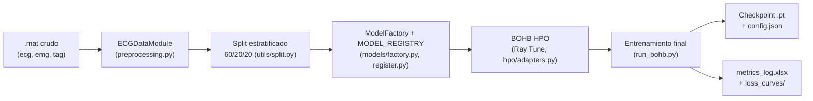

# ecgi-1d-architectures-comparison

> Comparación sistemática de arquitecturas 1D de deep learning para
> regresión de señales electrofisiológicas (ECG ↔ EMG) en el contexto de
> electrocardiografía por imágenes (ECGi).

Este `README.md` es el punto de entrada del proyecto. La organización de
carpetas, documentación y automatización de este repositorio está
**alineada con los principios** (no certificada) de ISO/IEC 5338,
ISO/IEC/IEEE 12207, ISO/IEC/IEEE 15289, ISO/IEC/IEEE 42010, ISO/IEC 23053,
ISO/IEC 5259, ISO/IEC 25010, ISO/IEC/IEEE 26514, ISO/IEC 23894,
ISO/IEC 24029, así como con las prácticas de Model Cards, Datasheets for
Datasets, MLOps, FAIR, SPDX y Citation File Format. Ver
`COMPLIANCE_MATRIX.md` para el detalle artefacto por artefacto.

## 1. Nombre del proyecto

**ecgi-1d-architectures-comparison**

## 2. Descripción

Pipeline de entrenamiento y optimización de hiperparámetros (HPO) que
entrena y compara **36 arquitecturas 1D** de deep learning (CNN, RNN,
híbridas CNN+RNN y basadas en atención/transformers) sobre 5 conjuntos de
datos electrofisiológicos, evaluando su capacidad de traducir una señal de
entrada (ECG o EMG) en la señal complementaria.

## 3. Problema abordado

Estimar una señal fisiológica (EMG) a partir de otra (ECG), o su inversa,
es relevante para electrocardiografía por imágenes (ECGi) y análisis de
señales cardíacas no invasivas.

```text
TODO: completar la descripción clínica del problema (relación ECGi/EMG
específica del dominio de aplicación, formulación exacta usada en el
trabajo de investigación asociado).
```

## 4. Objetivo general

Comparar de forma reproducible el desempeño de múltiples familias de
arquitecturas de deep learning 1D en la tarea de regresión secuencia-a-
secuencia ECG↔EMG, usando un procedimiento común de partición de datos,
optimización de hiperparámetros y métricas de evaluación.

## 5. Características principales

- **36 arquitecturas** registradas: CNN (`src/models/cnnbased/`), RNN
  (`src/models/rnnbased/`), híbridas (`src/models/hybridbased/`) y basadas
  en atención (`src/models/atbased/`).
- **HPO automatizado** con Ray Tune + BOHB (`TuneBOHB` +
  `HyperBandForBOHB`) por arquitectura y dataset.
- **Registro extensible de modelos y espacios de búsqueda**
  (`src/models/register.py`) — agregar una arquitectura nueva no requiere
  modificar el pipeline de entrenamiento.
- **Reproducibilidad de semillas** centralizada (Python `random`, NumPy,
  PyTorch, split de datos) — ver `docs/reproducibility.md`.
- **Métricas de evaluación específicas de señal**: MAE, MSE, RMSE,
  coeficiente de correlación, similitud coseno espectral y correlación
  cruzada máxima (`src/utils/metrics.py`).
- Soporte para dos direcciones de regresión: `ecg2emg` y `emg2ecg`.

## 6. Arquitectura general

Ver `docs/architecture.md` para el detalle completo con diagramas Mermaid.
Resumen del flujo:



## 7. Estructura del repositorio

```text
.
├── src/                    # código fuente (import root plano, ver docs/adr/0002)
│   ├── run_bohb.py         # punto de entrada principal (CLI)
│   ├── models/              # arquitecturas + registro (factory.py, register.py)
│   ├── data/                 # ECGDataModule, preprocesamiento, datasets
│   ├── hpo/, optimization/   # adaptadores de espacio de búsqueda para Ray Tune
│   ├── training/             # motor de entrenamiento alternativo (deprecado, ver MIGRATION_REPORT.md)
│   ├── utils/                 # semillas, métricas, splits, chequeos de NaN/Inf
│   ├── configs/                # dataclasses de configuración (config.py, configs/base_config.py)
│   ├── data/<dataset>/raw/     # datos crudos .mat (no versionados)
│   ├── checkpoints/             # pesos entrenados .pt + config.json (no versionados)
│   └── loss_curves/             # curvas de entrenamiento opcionales (--save-curves)
├── configs/                  # YAML externos de configuración (nuevo, ver sección 10)
├── data/README.md            # ficha de datos (sin datos pesados)
├── docs/                      # documentación técnica ISO-alineada + ADR
├── experiments/               # registro de experimentos
├── models/README.md           # ficha de checkpoints/modelos entrenados
├── reports/                    # resultados, tablas y figuras versionables
├── scripts/                    # wrappers finos sobre run_bohb.py
├── tests/                      # pruebas unitarias, integración, datos, modelo, smoke
└── .github/                    # CI, plantillas de issues/PR, dependabot
```

## 8. Requisitos

- Python ≥ 3.10 (ver `INSTALL.md` para detalle completo de SO/CPU/GPU/RAM).
- PyTorch ≥ 2.0.
- GPU NVIDIA recomendada para entrenamientos reales (CPU es viable solo
  para pruebas/smoke tests con `--num-samples`/`--max-epochs` reducidos).
- Ray[tune], PyTorch Lightning, HpBandSter + ConfigSpace (backend de BOHB).

## 9. Instalación rápida

```bash
git clone git@github.com:dmayorcatorres/cgan-ecgi.git
cd ecgi-1d-architectures-comparison
python3 -m venv .venv && source .venv/bin/activate
pip install -r requirements.txt
# desarrollo/pruebas:
pip install -r requirements-dev.txt
```

Ver `INSTALL.md` para instalación con Docker, solución de errores comunes
y desinstalación.

## 10. Configuración

Los hiperparámetros de entrenamiento y las variantes de modelo a evaluar
se controlan hoy mediante:

- `src/configs/base_config.py` (`TrainingConfig`) y `src/config.py`
  (`DataConfig`) — dataclasses consumidas por el pipeline.
- Argumentos de CLI de `src/run_bohb.py` (`--dataset`, `--method`,
  `--direction`, `--num-samples`, `--max-epochs`, `--save-curves`).
- Espacios de búsqueda de hiperparámetros por arquitectura, definidos en
  `SPACE_REGISTRY` (`src/models/register.py`).

Como complemento **no invasivo**, se añaden plantillas YAML en `configs/`
(`configs/data/`, `configs/model/`, `configs/training/`,
`configs/evaluation/`) que documentan explícitamente los valores por
defecto reales usados por el código, como paso previo a una futura
migración completa a configuración externa (ver
`docs/adr/0003-estrategia-configuracion.md`). **El pipeline activo sigue
leyendo su configuración desde `run_bohb.py`/`base_config.py`**; los YAML
son documentación ejecutable de referencia, no (todavía) la fuente de
verdad.

Variables de entorno opcionales: ver `.env.example`.

## 11. Preparación de datos

```text
TODO: documentar el procedimiento exacto de adquisición/descarga de los
datasets clínicos (auckland, bordeaux, ckitpvc, kitpvc, utah2002). Ver
data/README.md y docs/data_documentation.md — el origen y la licencia de
estos datos no estaban documentados en el repositorio original.
```

Formato esperado por `ECGDataModule` (`src/data/datamodule.py`): archivo
`.mat` con claves `ecg`, `emg`, `tag`, ubicado en:

```text
src/data/<dataset>/raw/<dataset>.mat      # ckitpvc, auckland, bordeaux, utah2002
src/data/kitpvc/kitpvc.mat                 # kitpvc (sin subcarpeta raw/)
```

## 12. Entrenamiento

```bash
cd src
python run_bohb.py --dataset kitpvc --method mlp \
    --direction ecg2emg --num-samples 15 --max-epochs 50
```

Barrido completo (36 modelos × 4 datasets):

```bash
cd src
bash run_experiments.sh
# variables opcionales: DATASETS, METHODS, DIRECTION, NUM_SAMPLES, MAX_EPOCHS, SAVE_CURVES
```

## 13. Evaluación

La evaluación (test held-out del split 60/20/20) se ejecuta como parte del
mismo `run_pipeline()` en `src/run_bohb.py`, usando
`ECGMetricsCalculator` (`src/utils/metrics.py`): MAE, MSE, RMSE,
coeficiente de correlación, similitud coseno espectral y correlación
cruzada máxima. Los resultados se anexan a `src/metrics_log.xlsx`.

## 14. Inferencia

```text
TODO: no existe actualmente un script de inferencia standalone
(scripts/predict.py) independiente del flujo de entrenamiento/HPO. Se deja
como recomendación en MIGRATION_REPORT.md — la carga de un checkpoint ya
entrenado es posible manualmente vía torch.load(..., weights_only=True) +
ModelFactory, pero no está empaquetada como comando de usuario.
```

## 15. Reproducción de resultados

```bash
cd src
python run_bohb.py --dataset <dataset> --method <variante> \
    --direction ecg2emg --num-samples 15 --max-epochs 50
```

La semilla global (`GLOBAL_SEED`, `src/utils/runtime.py::set_seed`) fija
Python `random`, NumPy y PyTorch, y el split de datos usa la misma
semilla. **PyTorch en GPU no garantiza determinismo bit-a-bit** salvo que
se active `torch.use_deterministic_algorithms(True)` (actualmente
`STRICT_DETERMINISM=False` por defecto). Ver `docs/reproducibility.md`
para el detalle y limitaciones conocidas.

## 16. Pruebas

```bash
pytest tests/unit tests/data tests/model -q
pytest tests/smoke -q -m smoke   # más lento, ejecuta un ciclo mínimo del pipeline
```

Ver resultados de la última ejecución de referencia en la entrega de esta
migración (sección "Pruebas ejecutadas" del informe) y en CI
(`.github/workflows/tests.yml`).

## 17. Resultados principales

```text
TODO: src/metrics_log.xlsx contiene resultados históricos de ejecuciones
reales, pero no se resumen aquí como tabla fija porque (a) el archivo se
sobrescribe/crece en cada corrida y (b) publicar una tabla estática en el
README quedaría desactualizada de inmediato. Ver docs/experiments.md y
experiments/experiment_registry.csv para el mecanismo de trazabilidad, y
consultar src/metrics_log.xlsx directamente para los resultados vigentes.
```

## 18. Limitaciones

- No hay separación por paciente/sujeto documentada explícitamente en el
  split — TODO: confirmar si `utils/split.py` garantiza que un mismo
  sujeto no aparezca en train y test (riesgo de fuga de datos, ver
  `docs/risks_and_limitations.md`).
- Determinismo no garantizado en GPU (ver sección 15).
- Sin script de inferencia independiente del pipeline de entrenamiento.
- Ver matriz completa de riesgos en `docs/risks_and_limitations.md`.

## 19. Consideraciones éticas y de uso

Los datos son señales electrofisiológicas humanas.

```text
TODO: el equipo debe completar el estado de anonimización, consentimiento
informado y aprobación ética (comité institucional) bajo el cual se
recolectaron los datasets auckland, bordeaux, ckitpvc, kitpvc, utah2002 —
esta información no estaba presente en el repositorio original y no debe
inferirse.
```

Este software es de uso en investigación; no está validado para uso
clínico ni diagnóstico. Ver `docs/model_card.md`, sección "usos no
recomendados".

## 20. Licencia

Código bajo licencia MIT (ver `LICENSE`). Los datasets pueden tener
licencias/restricciones propias — ver `data/README.md`.

## 21. Autores y responsables

- Dago Mayorca Torres — `dmayorca@umariana.edu.co`

Ver `CITATION.cff` para metadatos completos de autoría/afiliación (con
TODO donde falta confirmar información institucional).

## 22. Citación

Ver `CITATION.cff`. Ejemplo de cita en texto:

```text
Mayorca Torres, D. (2026). ecgi-1d-architectures-comparison [Software].
TODO: completar con la referencia definitiva (DOI, journal o trabajo de
grado) cuando exista.
```

## 23. Contribuciones

Ver `CONTRIBUTING.md` para el flujo de trabajo, convención de commits y
guía para añadir nuevas arquitecturas o datasets.
