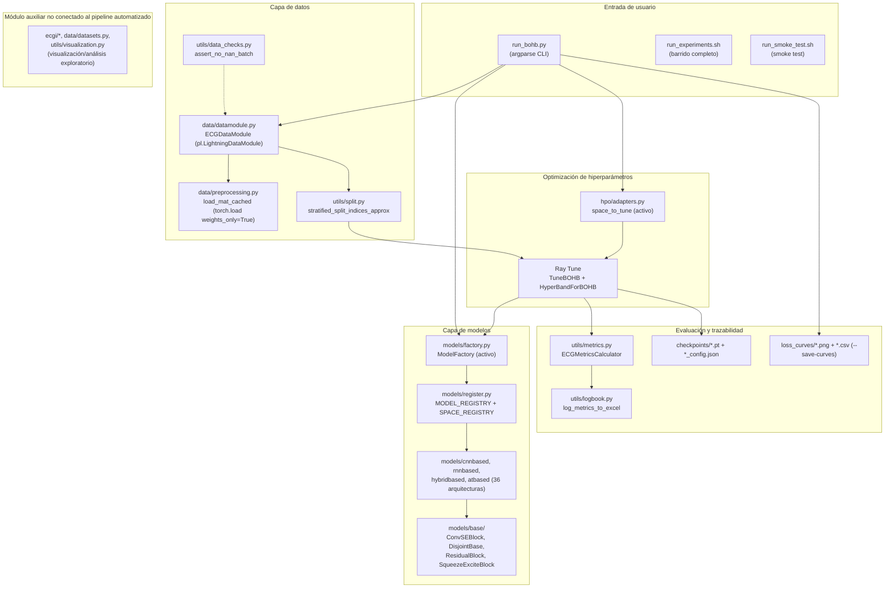

# Arquitectura del sistema

Alineado con los principios de ISO/IEC/IEEE 42010 (descripción de
arquitectura) e ISO/IEC 23053 (marco de sistemas ML). No implica
certificación bajo esos estándares.

## Contexto

El sistema es un pipeline de investigación (no un servicio en producción)
que entrena y compara arquitecturas 1D de deep learning para regresión de
señales electrofisiológicas ECG↔EMG. Se ejecuta de forma batch, por línea
de comandos, típicamente en una estación de trabajo o servidor con GPU
dedicada.

## Interesados (stakeholders)

| Interesado | Interés |
|---|---|
| Investigador/responsable (autor) | Ejecutar comparaciones reproducibles entre arquitecturas y datasets |
| Institución académica (Universidad Mariana) | Trazabilidad y calidad metodológica de los resultados publicables |
| Futuros colaboradores/mantenedores | Poder extender el registro de modelos/datasets sin romper el pipeline existente |

## Necesidades

- Entrenar y comparar múltiples arquitecturas bajo condiciones
  controladas (mismo split, misma semilla, mismas métricas).
- Registrar resultados de forma trazable para análisis posterior.
- Permitir agregar arquitecturas o datasets nuevos sin reescribir el
  pipeline central.

## Componentes y módulos

`models/model_factory.py`, `optimization/ray_optimizer.py`,
`optimization/hpo_spaces.py` y `training/engines.py` existieron como
código duplicado/no referenciado (verificado por trazado de imports desde
`run_bohb.py`) y fueron **eliminados** en el refactor del 2026-08-01 —
ver `docs/adr/0004-codigo-deprecado.md` (sección "Resolución") y
`MIGRATION_REPORT.md`, "Fase 5".

## Flujo de datos

1. Un archivo `.mat` (`ecg`, `emg`, `tag`) se carga y cachea vía
   `ECGDataModule.prepare_data()` → `load_mat_cached()`
   (`torch.load(..., weights_only=True)`).
2. Según `direction` (`ecg2emg`/`emg2ecg`), se define `x`/`y`.
3. `stratified_split_indices_approx()` genera índices train/val/test
   (60/20/20) reproducibles con `GLOBAL_SEED=42`.
4. `ModelFactory` (`models/factory.py`) instancia la arquitectura elegida
   con los hiperparámetros comunes (`time_steps`, `input_channels`,
   `output_channels`) más los del trial actual.
5. Ray Tune ejecuta BOHB sobre el espacio de búsqueda de
   `SPACE_REGISTRY[variant]`, entrenando y evaluando cada trial.
6. El mejor trial se reentrena (`final_epochs`) y se evalúa en el split de
   test held-out con `ECGMetricsCalculator`.
7. Resultados → `metrics_log.xlsx`; checkpoint → `checkpoints/`; curvas
   opcionales → `loss_curves/`.

## Pipeline de entrenamiento

Ver sección "Flujo de datos" (pasos 3–6). Implementado íntegramente en
`src/run_bohb.py::run_pipeline()`.

## Pipeline de evaluación

Evaluación held-out ejecutada al final de `run_pipeline()`, reutilizando
el split de test generado en el mismo proceso (no hay un script de
evaluación desacoplado del entrenamiento — ver limitación en `README.md`).

## Pipeline de inferencia

No existe actualmente como componente independiente (ver
`MIGRATION_REPORT.md` y `docs/deployment.md`).

## Dependencias externas

PyTorch, Ray[tune], PyTorch Lightning, HpBandSter, ConfigSpace, NumPy,
SciPy, pandas, openpyxl (persistencia de `metrics_log.xlsx`), matplotlib
(curvas/visualización). Ver `requirements.txt` para el listado completo
verificado contra los imports reales del código.

## Interfaces

- **CLI** (`run_bohb.py`, `argparse`): única interfaz de usuario actual.
- **Registro de modelos** (`models/register.py`): interfaz de extensión
  interna (`register_model`, `register_space`) para añadir arquitecturas.
- No hay API HTTP/RPC ni interfaz gráfica.

## Persistencia

- Datos crudos: `.mat` en `src/data/<dataset>/raw/` (no versionados).
- Checkpoints: `.pt` + `.json` en `src/checkpoints/` (no versionados).
- Resultados agregados: `src/metrics_log.xlsx` (versionado históricamente
  en git; ver recomendación de moverlo a `reports/` en
  `MIGRATION_REPORT.md`).
- Estado de Ray Tune: `src/ray_results/` (históricamente versionado en
  git; purgado del historial, ver `MIGRATION_REPORT.md`).

## Despliegue

No hay despliegue en producción; el "despliegue" actual es la ejecución
del contenedor Docker (`Dockerfile`, `compose.yaml`) en una máquina con
GPU para lanzar entrenamientos batch. Ver `docs/deployment.md`.

## Monitoreo

No hay monitoreo de un servicio en producción (no aplica: el sistema no
sirve inferencia online). El "monitoreo" relevante es el seguimiento de
métricas de entrenamiento/HPO, hoy limitado a logs de consola y
`metrics_log.xlsx`. Ver `docs/monitoring.md` para recomendaciones.

## Riesgos técnicos

Ver matriz completa en `docs/risks_and_limitations.md`. Resumen de los
riesgos de mayor relevancia arquitectónica:

- Dos factories de modelos y dos motores de entrenamiento coexistiendo
  (uno activo, uno huérfano) — riesgo de que un colaborador nuevo edite el
  código equivocado.
- Sin separación verificada por sujeto en el split — riesgo de fuga de
  datos.
- Sin determinismo estricto en GPU por defecto.

## Decisiones arquitectónicas

Ver `docs/adr/`.
